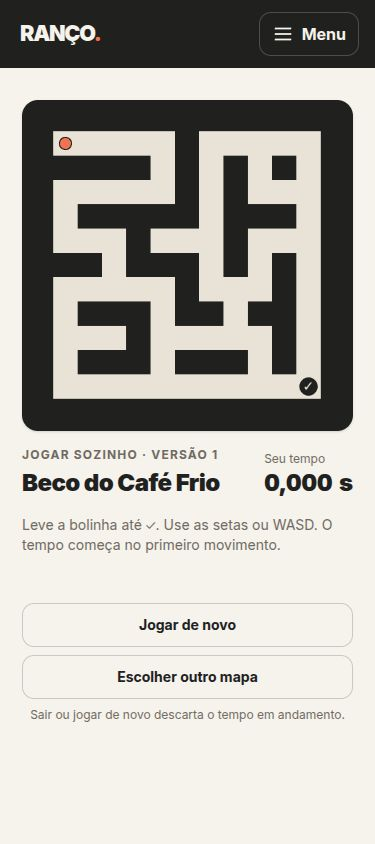
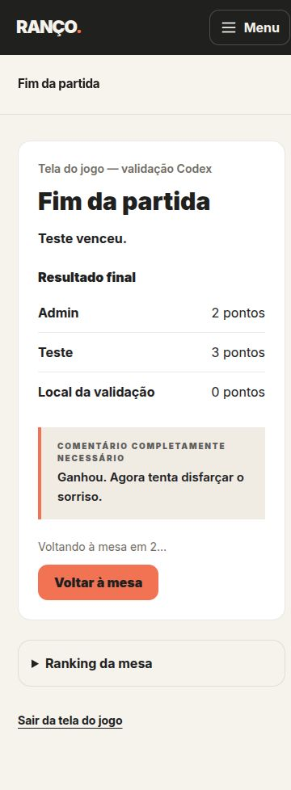

# RANÇO — jogo social com Laravel e Phaser

**Competição por coisas completamente inúteis.**

O **RANÇO** é uma aplicação web de jogos sociais. Participantes criam mesas, convidam outras pessoas, disputam partidas e acumulam pontos em um ranking. O projeto combina regras de negócio em PHP, interface interativa e comunicação em tempo real.

> **Edição de portfólio:** este repositório contém o jogo **Labirinto** e a infraestrutura de plataforma necessária para executá-lo. É um recorte independente do projeto original, sem importar seu histórico de commits. Outros jogos não fazem parte desta edição.

## Demonstração visual

### Labirinto — modo solo



### Partida e acompanhamento



As imagens estão incluídas no próprio repositório. A execução local não depende de um site externo.

## O que este projeto demonstra

- **Regras de domínio em PHP:** separação entre lógica das partidas, persistência e interface; validação de mapas e resultados.
- **Concorrência e persistência:** operações transacionais e controle de atualizações de partidas e tentativas.
- **Comunicação em tempo real:** Laravel Reverb e Echo para eventos de mesas, convites e acompanhamento visual das jogadas.
- **Frontend de jogo:** Phaser para a cena do Labirinto, com controles e lógica de movimento próprios.
- **Qualidade e manutenção:** testes PHP e JavaScript, análise estática com PHPStan/Larastan, formatação com Pint e ambiente Docker.

O acompanhamento visual usa amostras enviadas pelo navegador. Essa transmissão **não deve ser confundida com uma verificação antitrapaça completa no servidor**.

## Funcionalidades incluídas

- **Labirinto solo:** tentar superar o próprio melhor tempo.
- **Labirinto em mesa:** partidas entre participantes, com turnos e classificação por tempo.
- **Assistir ao vivo:** outros integrantes da mesa acompanham visualmente a jogada.
- **Plataforma social:** contas, amizades, convites e participantes locais no mesmo aparelho.
- **Progressão:** ranking da mesa, conquistas, troféus e provocações do personagem “Tom”.
- **Administração e observabilidade:** painel Filament e Laravel Pulse, com acesso restrito.

## Tecnologias

| Camada | Tecnologias |
| --- | --- |
| Backend | PHP 8.5, Laravel 13 |
| Interface web | Livewire 4, Tailwind CSS 4 |
| Jogo | Phaser 3 |
| Tempo real | Laravel Reverb, Laravel Echo |
| Banco de dados | MariaDB |
| Administração | Filament 5, Laravel Pulse |
| Ambiente | Docker e Docker Compose |
| Testes e análise | PHPUnit, Vitest, PHPStan/Larastan, Laravel Pint |

## Executar localmente

**Pré-requisitos:** Docker e Docker Compose. PHP, Composer, Node e MariaDB são utilizados dentro dos containers.

```bash
git clone https://github.com/caiofcosta/ranco.git
cd ranco
cp .env.example .env

./dev.sh up
./dev.sh composer install
./dev.sh artisan key:generate
```

Antes de compilar os assets, defina no `.env` as chaves locais do Reverb, por exemplo:

```dotenv
REVERB_APP_ID=local-app-id
REVERB_APP_KEY=chave-local-de-exemplo
REVERB_APP_SECRET=segredo-local-de-exemplo
VITE_REVERB_APP_KEY=chave-local-de-exemplo
```

`VITE_REVERB_APP_KEY` deve coincidir com `REVERB_APP_KEY`. Esses são apenas valores ilustrativos para **ambiente local**; use credenciais únicas e seguras em qualquer ambiente exposto à internet.

```bash
./dev.sh npm ci
./dev.sh build
./dev.sh migrar
./dev.sh artisan db:seed
```

A aplicação ficará em **http://127.0.0.1:8080**.

| Recurso | Endereço local |
| --- | --- |
| Página inicial | http://127.0.0.1:8080 |
| Labirinto solo | http://127.0.0.1:8080/jogar/labirinto |
| Painel administrativo | http://127.0.0.1:8080/painel |
| Laravel Pulse | http://127.0.0.1:8080/pulse |

O painel e o Pulse exigem uma conta autorizada. Cadastre o e-mail administrativo em `RANCO_ADMINISTRADORES` no `.env`. Em desenvolvimento, o envio de e-mail usa log: consulte `./dev.sh emails` para acessar os links gerados.

### Experimentar o multiplayer

1. Abra duas sessões de navegador e entre com contas diferentes.
2. Crie uma mesa na primeira conta e convide a segunda.
3. Aceite o convite, selecione **Labirinto** e inicie a partida.
4. Jogue em uma sessão e use **Assistir** na outra.
5. Confira o resultado e o ranking após a rodada.

O serviço Reverb e o agendador são iniciados com o ambiente Docker. Se alterar valores `VITE_*`, recompile os assets com `./dev.sh build`.

## Testes e verificações

```bash
./dev.sh test          # Testes PHP e JavaScript
./dev.sh teste-banco   # Testes de repositórios no MariaDB
```

A suíte inclui testes de regras de domínio, mapas, partidas e transmissão visual. Ter esses testes no repositório **não significa que a suíte tenha sido executada ou aprovada nesta revisão**.

## Estrutura do código

- `app/Dominio/` — regras de negócio independentes da interface.
- `app/Infra/` — implementação de persistência e integração com o banco.
- `app/Mesa/` — operações e apresentação das mesas.
- `resources/js/jogos/labirinto/` — cena, movimento, controles e transmissão do jogo.
- `tests/Unit/`, `tests/Feature/` e `tests/JavaScript/` — testes.
- `docs/` — decisões de produto e documentação complementar.

## Limitações

- Esta edição disponibiliza somente o **Labirinto**; rotas de jogos removidos retornam 404.
- Em desenvolvimento, os e-mails são gravados em log, não enviados.
- Login com Google é opcional e requer credenciais próprias.
- O acompanhamento em tempo real exige que o Reverb esteja funcionando e acessível pelo navegador.
- Não há hospedagem pública garantida para esta edição; a forma reproduzível de avaliá-la é executar localmente.

Para aspectos de implantação, consulte [Implantação e segurança](docs/publicacao.md).

## Direitos de uso

**Todos os direitos reservados.** O projeto está identificado como `proprietary` no `composer.json`. Disponibilizar o código para consulta e avaliação **não concede automaticamente autorização de uso, modificação ou redistribuição**. Este repositório não está sendo apresentado como software de código aberto licenciado.

As dependências de terceiros continuam sujeitas às próprias licenças.
